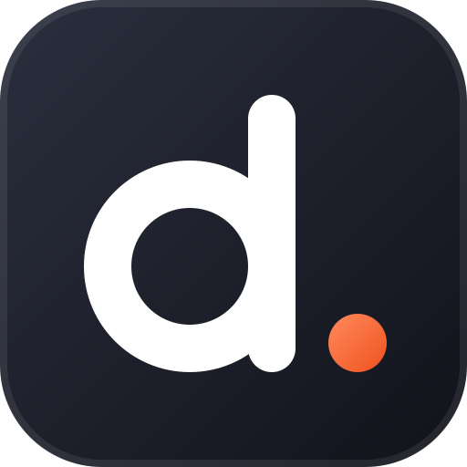

<p align="center">
  
</p>

<h1 align="center">duka.tr</h1>

**Source of the [duka.tr](https://duka.tr) website: the home page, app pages and privacy policies.**

duka.tr builds open-source, ad-free apps and web tools that keep your data on your device. This repository is the
site that presents them. It is plain HTML and CSS with one small script, served by GitHub Pages. There is no build
step, no framework, no external fonts, no cookies, no analytics and no trackers.

**Live:** [duka.tr](https://duka.tr)

---

## Pages

| Path | Page |
| --- | --- |
| [`/`](https://duka.tr/) | Home page: principles and the list of apps and tools |
| [`/scanread/`](https://duka.tr/scanread/) | [ScanRead](https://github.com/duka-tr/scan-read), on-device screen translation for Android |
| [`/scanread/privacy/`](https://duka.tr/scanread/privacy/) | ScanRead privacy policy (linked from the app and the store listing) |
| [`/diff/`](https://duka.tr/diff/) | [DUKA Diff](https://github.com/duka-tr/diff), served from its own repository |
| `404.html` | "Page not found" page for the whole domain |

`/diff/` is not in this repository. GitHub Pages serves the `duka-tr/diff` project site under this domain.

## Privacy

The site follows the same rules as the apps:

- No cookies, analytics, tracking pixels, external fonts or third-party scripts.
- Every page has a Content Security Policy that allows only files from duka.tr itself, so nothing can be loaded
  from another server by accident.
- The only thing stored in the browser is the language you pick with the **EN / TR** buttons (`duka.lang` in
  `localStorage`). Nothing is stored if you never press them.

## Languages

Every page is in English and Turkish. Both languages are in the same HTML file, and `assets/lang.js` picks one
before the page is drawn:

1. `#english` or `#turkce` in the URL (the privacy policy uses these anchors),
2. the language the visitor chose earlier with the **EN / TR** buttons,
3. the browser's language list,
4. English.

Without JavaScript the pages are shown in English, and the privacy policy shows both languages.

Marking text in HTML:

```html
<p data-l="en">Translate the text on your screen.</p>
<p data-l="tr">Ekrandaki metni çevirin.</p>

<!-- Inline, inside a single element -->
<h2><span data-l="en">Support</span><span data-l="tr">Destek</span></h2>

<!-- Page title and aria-labels -->
<html lang="en" data-title-en="…" data-title-tr="…">
<nav aria-label="Main menu" data-aria-en="Main menu" data-aria-tr="Ana menü">
```

## Running locally

The pages use root-relative paths (`/assets/style.css`), so serve the repository root over HTTP instead of opening
the files directly:

```sh
python -m http.server 8000
# or
npx serve .
```

Then open <http://localhost:8000>. `/diff/` will not work locally because it lives in another repository.

## Deployment

GitHub Pages publishes the `main` branch as is. `CNAME` sets the custom domain, and `.nojekyll` turns off Jekyll so
that every file, including `.well-known/`, is served unchanged. A push to `main` is live within a few minutes.

## Adding an app page

1. Create `<app>/index.html`, starting from `scanread/index.html`: shared header, language buttons and footer.
2. Add the app's icon to `assets/` as SVG, plus a 512 px PNG for `apple-touch-icon` and `og:image`.
3. Give the page its own accent color with a body class, like `theme-scanread` in `assets/style.css`.
4. Add an app card to the home page (`#apps`), and the page to the footer links, `404.html` and `sitemap.xml`.
5. If the app has a privacy policy, put it at `<app>/privacy/` so store listings can link to a stable address.

## Project structure

```
.
├── index.html                Home page
├── 404.html                  Not-found page for the whole domain
├── scanread/
│   ├── index.html            ScanRead page
│   └── privacy/index.html    ScanRead privacy policy
├── assets/
│   ├── style.css             Shared styles, light and dark themes, per-app accent colors
│   ├── lang.js               English / Turkish language selection
│   ├── duka-logo.svg         duka.tr logo (header, favicon); duka-icon-512.png for sharing previews
│   ├── scanread-logo.svg     ScanRead icon; scanread-icon-512.png for sharing previews
│   └── diff-logo.svg         DUKA Diff icon (home page card)
├── .well-known/security.txt  Contact for security reports
├── robots.txt, sitemap.xml   Search engine hints
├── CNAME                     Custom domain for GitHub Pages
└── LICENSE, NOTICE
```

## Support and contact

- Report problems with the site in [Issues](https://github.com/duka-tr/duka-tr.github.io/issues). Report problems
  with an app in that app's repository.
- Contact: [support@duka.tr](mailto:support@duka.tr)

## Contributing

Fixes for typos, translations and accessibility are welcome as pull requests. Please keep the site dependency-free.
Every visible text needs both an English and a Turkish version.

## License

Copyright 2026 duka.tr. The code is licensed under the [Apache License, Version 2.0](LICENSE).

The duka.tr, ScanRead and DUKA Diff names and logos identify duka.tr and its apps. The license does not allow using
them as the branding of another site or product (see [NOTICE](NOTICE)).
